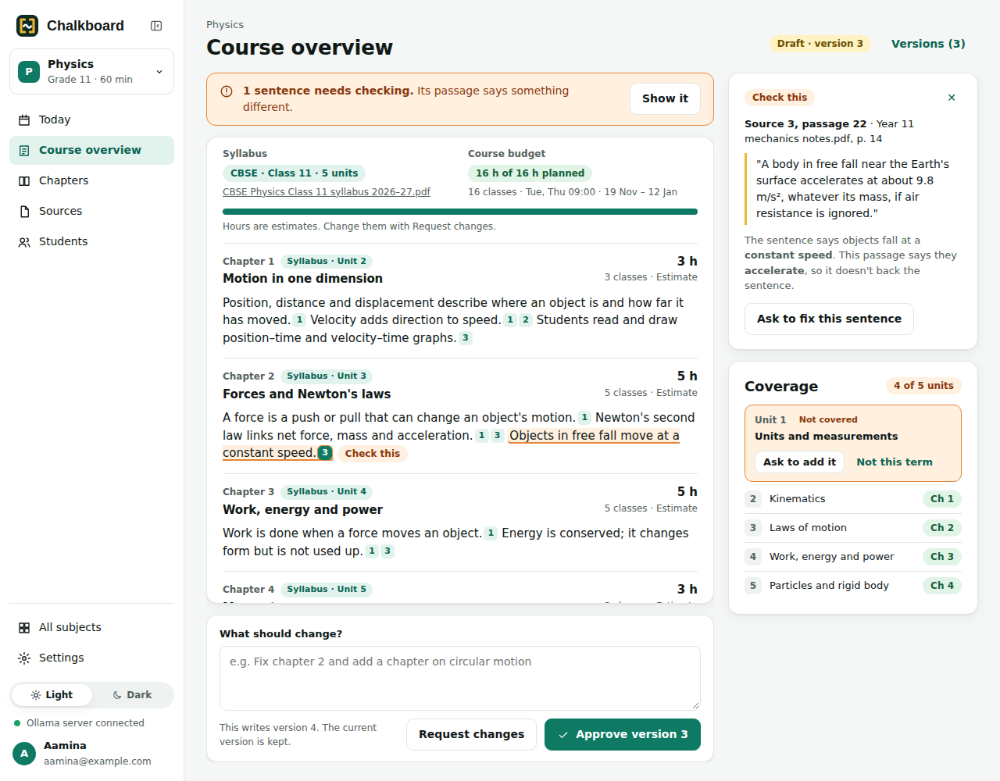
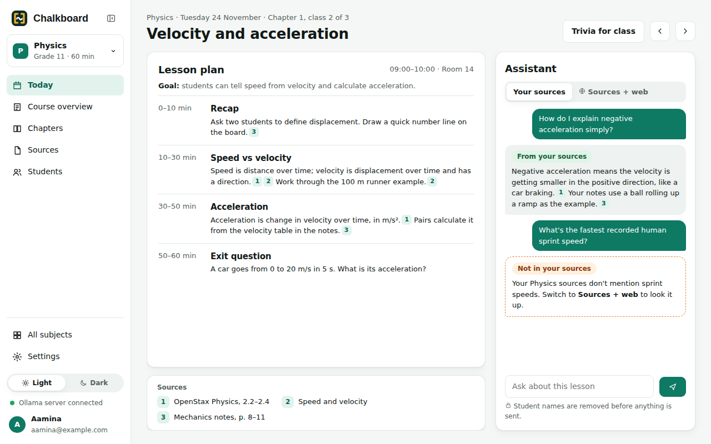
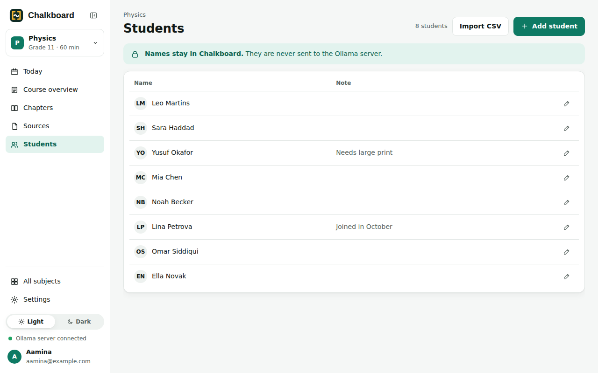
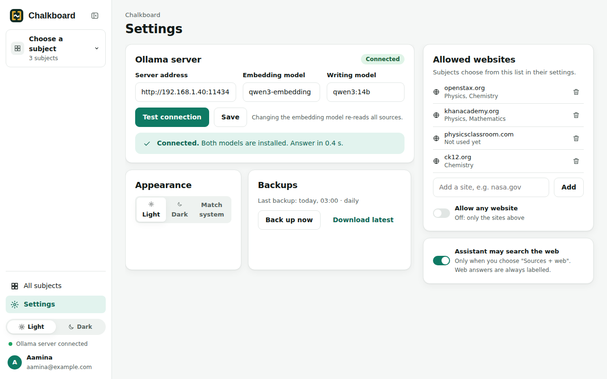
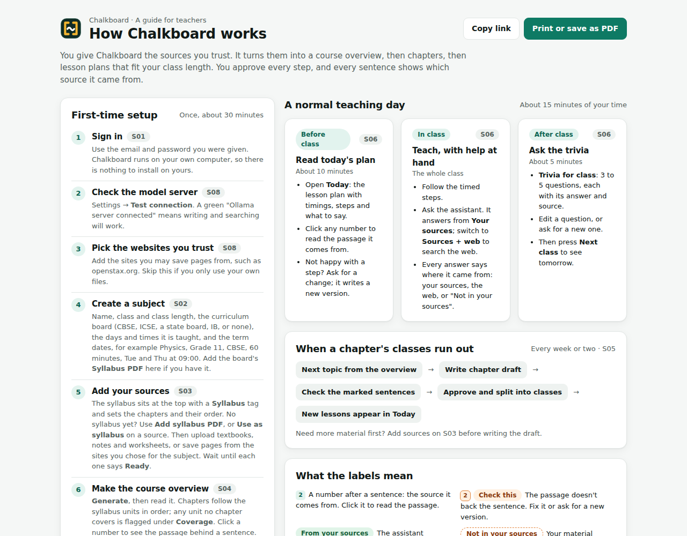

<!-- about -->

# Chalkboard

**Teacher-approved sources in, cited course plans out**

Website: [dmi.tabrez.xyz/p/chalkboard](https://dmi.tabrez.xyz/p/chalkboard)

## How to use it

Setting it up and using it, step by step: [the guide](design/guide.md).

## Screens

### S01 · Sign in

Sign in to the teacher's account

### S02 · Subjects

See every subject at a glance and create a new one

### S03 · Sources

Add, review and remove the sources a subject's plans are written from

### S04 · Overview

### S05 · Chapters and classes

Write, approve and split each chapter into class-length lessons

### S06 · Today

Teach today's lesson from its plan, with its sources and an assistant

### S07 · Students

Keep the class list for a subject

### S08 · Settings

Connect the Ollama server, choose allowed websites, theme, backups and deletion

### S09 · Teacher Guide

<!-- /about -->

## Development

Prerequisites: Docker with Compose, uv 0.13.9, Node.js (for `npx`).

- Install dependencies: `uv sync`
- Run everything: `docker compose up --build`, then http://localhost:8000/healthz returns `{"status": "ok"}`.
- Run the app locally against the Compose database: `docker compose up -d db`, `uv run alembic upgrade head`, `uv run flask --app chalkboard run --debug`
  - If `.env` sets a custom `POSTGRES_PASSWORD`, first run `export CHALKBOARD_DATABASE_URL="postgresql+psycopg://chalkboard:<POSTGRES_PASSWORD>@localhost:5432/chalkboard"`. Host commands don't read `.env`.
- Web search: `docker compose up -d searxng` serves SearXNG on http://127.0.0.1:8888 for local runs.
- New migration: `uv run alembic revision --autogenerate -m "<what changes>"`; apply it with `uv run alembic upgrade head`.
- Tests: `docker compose up -d db`, then `uv run pytest` (creates and drops `chalkboard_test`; override the URL with `CHALKBOARD_TEST_DATABASE_URL`).
- Create the first account: `uv run flask --app chalkboard create-teacher --email you@example.com --name "Your name"` (with Compose: `docker compose exec web flask --app chalkboard create-teacher ...`). It asks for the password twice.
- Reset a password: `uv run flask --app chalkboard reset-password --email you@example.com`.
- Run the worker locally: `uv run flask --app chalkboard worker` (Compose runs it as the `worker` service).
- The backup integration test needs `pg_dump` and `pg_restore` 19 on `PATH`; it is skipped locally without them and always runs in CI.
- Fonts: Inter and Raleway are bundled in `chalkboard/static/fonts/`; see its `README.md` for the source packages and licences.
- Format: `uv run ruff format . && npx prettier@3.10.1 --write .`
- Checks (same as CI): `uv run ruff format --check . && uv run ruff check .` and `npx prettier@3.10.1 --check .`

## Backups and restore

Backups are `chalkboard-YYYYMMDD-HHMMSS.tar.gz` archives in the `backups` volume: a `db.dump` of the database plus the `data/` folder with your source files. The worker makes one every day and keeps the newest 14. To make one now: `docker compose exec web flask backup` (or **Back up now** in Settings, when the server has a single account).

To restore into an empty database:

1. `docker compose stop web worker`
2. `docker compose exec db dropdb -U chalkboard chalkboard && docker compose exec db createdb -U chalkboard chalkboard`
3. `docker compose run --rm web flask restore /app/backups/<file>`
4. `docker compose up -d`

`flask restore` refuses a database that already has tables.

Configuration (environment variables):

- `CHALKBOARD_DATABASE_URL`: SQLAlchemy URL of the PostgreSQL database.
- `CHALKBOARD_SECRET_KEY`: key that signs sessions.
- `CHALKBOARD_DATA_DIR`: where uploaded files and other data are stored.
- `CHALKBOARD_BACKUP_DIR`: where backups are written.
- `CHALKBOARD_DAILY_BACKUP`: `true` (default) lets the worker back up daily; `false` turns that off.
- `CHALKBOARD_OLLAMA_URL`: address of the Ollama server (default `http://localhost:11434`); Settings can override it.
- `CHALKBOARD_EMBED_MODEL`: embedding model (default `qwen3-embedding:0.6b`); Settings can override it.
- `CHALKBOARD_WRITE_MODEL`: writing model (default `qwen3.5:9b`); Settings can override it.
- `CHALKBOARD_SEARXNG_URL`: address of the SearXNG server (default `http://localhost:8888`; Compose sets `http://searxng:8080`).
- `SEARXNG_SECRET`: secret of the SearXNG container; set a real value in `.env` (`openssl rand -hex 32`).

Set a real `CHALKBOARD_SECRET_KEY` and `POSTGRES_PASSWORD` in a `.env` file next to `compose.yaml` for anything but local development. The password is placed inside the database URL, so use URL-safe values (no `@`, `:` or `/`): generate both with `openssl rand -hex 32`.

---

Created with ❤️ by Dunder Mifflin agents
