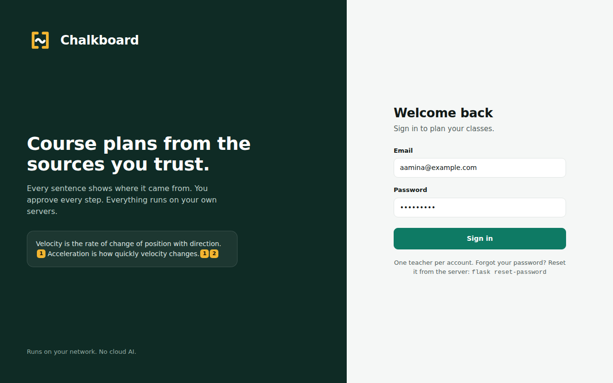
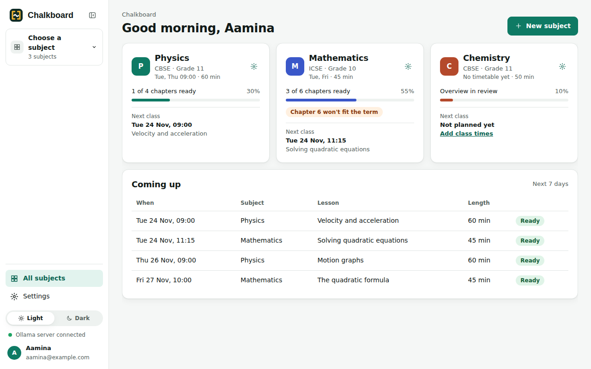
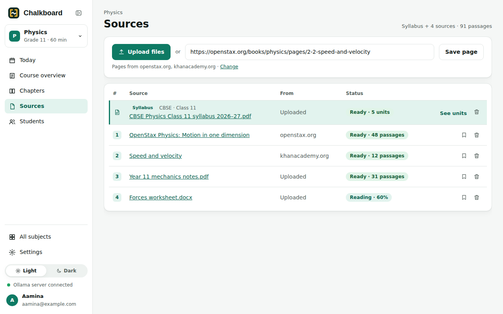
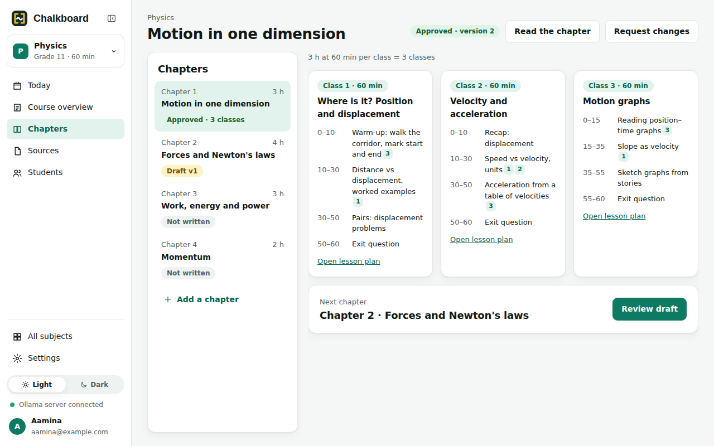

<!-- about -->
# Chalkboard

**Teacher-approved sources in, cited course plans out**

Website: [dmi.tabrez.xyz/p/chalkboard](https://dmi.tabrez.xyz/p/chalkboard)

## How to use it

Setting it up and using it, step by step: [the guide](design/guide.md).

## Screens

### S01 · Sign in

Sign in to the teacher's account

### S02 · Subjects

See every subject at a glance and create a new one

### S03 · Sources

Add, review and remove the sources a subject's plans are written from

### S04 · Overview

### S05 · Chapters and classes

Write, approve and split each chapter into class-length lessons

### S06 · Today

Teach today's lesson from its plan, with its sources and an assistant

### S07 · Students

Keep the class list for a subject

### S08 · Settings

Connect the Ollama server, choose allowed websites, theme, backups and deletion

### S09 · Teacher Guide

<!-- /about -->

## Development

TODO: build and test instructions, added with the first code.

---

Created with ❤️ by Dunder Mifflin agents
